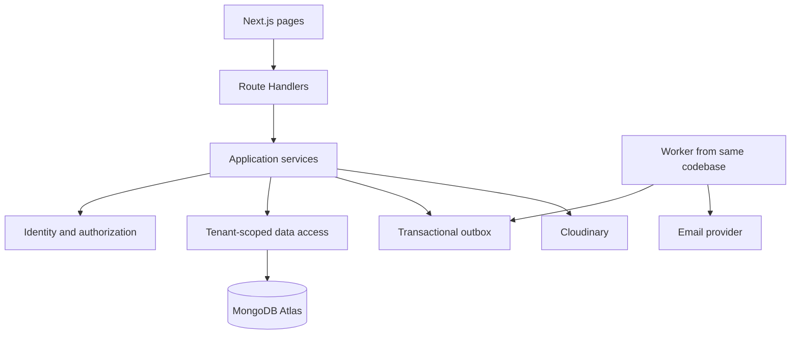
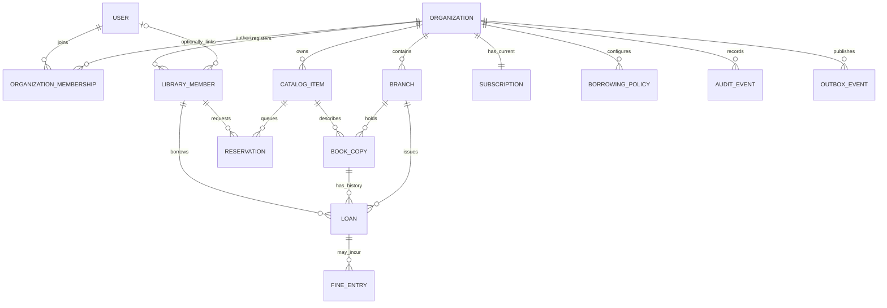
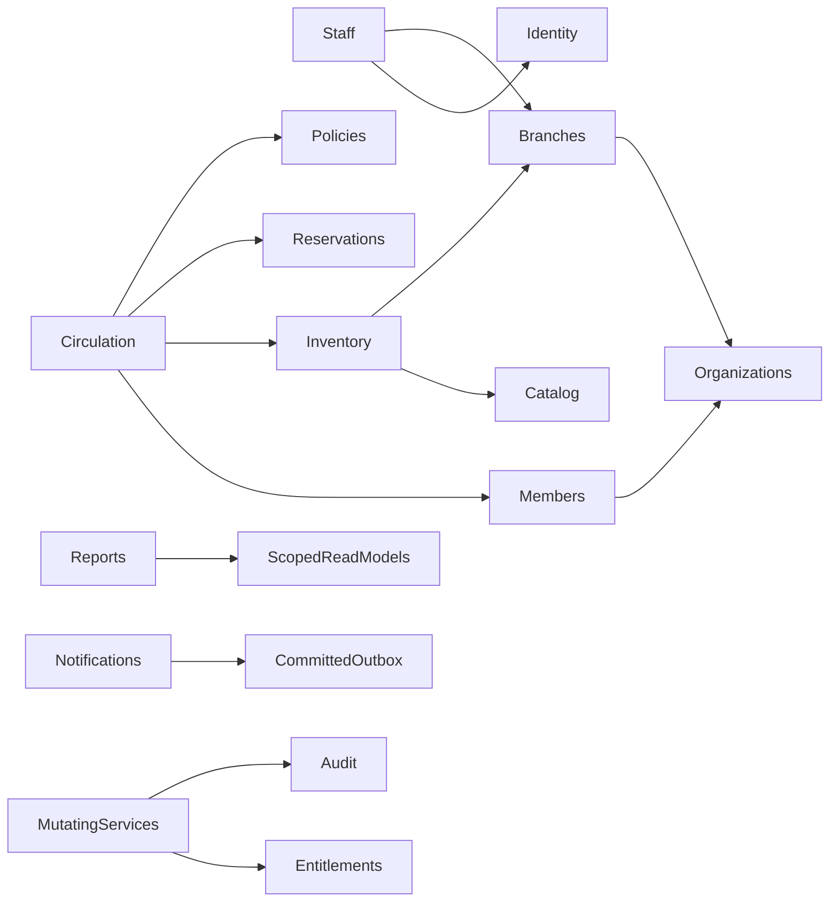

# LibraryOS architecture — initial design proposal

Status: detailed documentation for approval. Requirements baseline: [SRS.md](SRS.md), version 1.0. The user authorized expansion of the approved architecture proposal; application implementation remains unapproved.

This document defines boundaries and core relationships. The companion documents define database constraints, permissions, APIs, security and delivery. Operational defaults are not approved by this design.

## Requirements coverage and open issues

SRS sections 1–3 establish organization isolation, branches, fixed roles and multi-organization access. Sections 4–5 define physical inventory and circulation. Sections 6–7 establish subscriptions, reporting, notifications and audit. Sections 8–10 establish quality targets, stack and pilot delivery. Section 11 explicitly leaves business and operational decisions open.

The baseline covers all requested modules at feature level. Missing detail includes platform support access, protected Owner actions, patron account linking, reservation scope, policy precedence, cross-branch returns, transfer transitions, lost/damaged handling, fine settlement, over-limit behavior, data retention and measurable pilot acceptance criteria. These are decisions to resolve, not implied permissions or defaults.

## Runtime and module boundaries

Use the requested Next.js App Router, TypeScript, Tailwind CSS, shadcn/ui and Motion frontend. Route Handlers delegate to application services, which enforce authorization and business rules. Mongoose accesses MongoDB Atlas through focused data-access functions; avoid generic repository abstractions without a concrete need.

Run scheduled and asynchronous work through a worker entry point in the same modular-monolith codebase. Hosting and scheduling mechanism remain open. Cloudinary handles media, an undecided transactional provider handles email, and Recharts handles analytics presentation. Vitest and Playwright provide the requested test layers. No additional packages are selected in this step.

| Module | Owns |
| --- | --- |
| Authentication and users | Global identities, credentials, sessions and account recovery |
| Organizations | Workspace lifecycle, unique slug and organization settings |
| Branches | Branch lifecycle and organization association |
| Staff and permissions | Organization access, fixed role assignments, bounded capability customization and branch scope |
| Members | Library patron registration, eligibility, categories and account association |
| Catalog | Organization-owned bibliographic records and future resource-type metadata |
| Inventory | Physical copies, condition, location, transfers and adjustments |
| Circulation | Issue, return, loan lifecycle and coordination of renewals |
| Reservations and renewals | Ordered title queues, allocation, pickup expiry and renewal eligibility |
| Policies and fines | Versioned borrowing configuration and fine records |
| Reports | Authorized read models, dashboards and the five MVP reports |
| Notifications | In-app delivery, email delivery attempts and templates |
| Subscriptions | Current subscription relationship, entitlements and organization-wide quotas |
| Audit | Protected administrative and domain activity records |
| Platform administration | Explicitly authorized platform operations; support powers remain unresolved |

Module dependencies: branches depend on organizations; staff access depends on users, organizations and branches; inventory depends on catalog and branches; circulation depends on inventory, members, policies and reservations. Reports use scoped read models. Notification delivery consumes committed events. Authorization, quota enforcement and auditing apply across relevant services. Avoid circular service calls: circulation orchestrates a use case and passes its transaction context to participating domain operations.

## Proposed identity and ownership boundaries

1. `User` is a global login identity. It contains no implicit organization role.
2. `OrganizationMembership` associates one User with one organization and holds role and staff access settings. Changing the active workspace never changes the global identity.
3. `LibraryMember` is an organization-owned patron record. A proposed optional `userId` allows staff registration before account activation. Account claiming and identity verification must be approved before implementation.
4. Organization is the tenant, subscription and security boundary. Branch is an authorization and operational subdivision, not a separate tenant.
5. Catalog records belong to an organization; physical copies belong to that organization and one current branch. Loans retain the issuing branch independently of later inventory movement.
6. Every tenant-owned entity carries `organizationId`, even where another reference could indirectly identify the organization. Services validate that all referenced records share that organization.

One membership per user/organization is proposed. Whether a person may combine staff access with patron access and how Member roles are represented alongside staff roles remains open. Keep patron records separate regardless of the final role representation.

## Core entity relationships

Each copy can have many historical loans but at most one active loan. Reservation branch scope and allocation relationships remain undecided. Fine entries are provisional accounting entities: payment, waiver and recalculation semantics need approval. Subscription history may be retained separately from the one current relationship. Workspace creation must atomically create its Owner membership and current Free subscription.

## Integrity and security invariants

- Resolve tenant context from authenticated membership; validate any organization selected through the URL against it. Never trust client-provided roles or branch scope.
- Include tenant predicates in reads, writes, aggregations, joins, reports, jobs and exports. Explicitly define global exceptions for identity and platform operations.
- Check both tenant and branch access before accessing a branch resource. Branchless organization-wide operations require their own capabilities.
- Enforce a unique normalized workspace slug globally, a unique barcode within an organization, and at most one active loan per copy with database constraints in the later database design.
- Use MongoDB transactions for critical related mutations. Concurrent member limits, quota consumption, suspension changes and permission revocation need shared conditional writes or version guards; snapshot reads alone do not serialize these decisions.
- Commit business mutations, required audit events and outbox events together. Notification failure cannot reverse successful circulation. Workers must revalidate tenant state and perform retry-safe operations.
- Global sessions do not cache authoritative tenant permissions indefinitely. Enforce revocation, session expiry and fresh membership checks on protected operations.
- Use HTTPS, secure HttpOnly session cookies, CSRF defenses, password hashing, server validation, safe upload authorization, rate limiting, secret storage and sanitized errors.
- Suspension and subscription changes preserve records. The exact allowed operations during suspension or over-limit states require approval.
- Future digital resources introduce separate access/licensing behavior. Future billing providers integrate through subscription adapters without storing raw card data.

## Decisions awaiting approval

| ID | Decision | Recommendation or next action |
| --- | --- | --- |
| D01 | Global identity and organization access | Architecture basis: User plus OrganizationMembership |
| D02 | Patron identity | Separate LibraryMember with optional User association; claiming and verification: **PENDING APPROVAL** |
| D03 | Role combinations and Owner powers | Staff/patron coexistence, ownership transfer and final nondelegable capabilities: **PENDING APPROVAL** |
| D04 | Branch circulation and reservations | Queue scope, pickup branch, policy precedence, cross-branch returns and transfers: **PENDING APPROVAL** |
| D05 | Circulation defaults and exceptions | Limits, periods, renewals, validity, timezone rules, lost/damaged handling and fine lifecycle: **PENDING APPROVAL** |
| D06 | Subscription enforcement | Free thresholds, counted statuses and behavior at/above limits: **PENDING APPROVAL**; proposed SRS thresholds remain unapproved |
| D07 | Platform administration | Support data access, consent and administrative restrictions: **PENDING APPROVAL** |
| D08 | Notifications and privacy | Email provider, consent, export/deletion and retention rules: **PENDING APPROVAL** |
| D09 | Deployment and pilot | Hosting, worker operation, RPO/RTO, load profiles and go/no-go thresholds: **PENDING APPROVAL** |

## Subsequent document structure

- `DATABASE_DESIGN.md`: collection fields, cardinalities, tenant references, indexes, uniqueness, concurrency guards, transaction workflows and lifecycle transitions.
- `PERMISSIONS.md`: fixed-role matrix, customizable capabilities, protected Owner privileges, branch scope and platform access.
- `API_DESIGN.md`: tenant-explicit route structure, request/response contracts, validation, pagination, idempotency and safe error envelopes.
- `SECURITY.md`: threat model, authentication/session flows, authorization, CSRF, rate limits, uploads, secrets, privacy and recovery controls.
- `IMPLEMENTATION_PLAN.md`: dependency-ordered milestones, requirement traceability, Vitest/Playwright coverage, tenant-isolation and concurrency tests, accessibility checks and pilot gates.
- Expand this document with final deployment choices, folder structure and accepted decision records after review.

## Code organization and dependency rules

Proposed folders: `src/app` for pages and HTTP adapters; `src/modules/<domain>` for domain types, validation, services and data access; `src/server` for database connection, session resolution and shared transaction infrastructure; `src/workers` for job entry points; `tests` for integration and end-to-end suites. These are design paths, not created application files.

UI and handlers may call services but never make independent business writes. Services receive a trusted authorization context and optionally a transaction session. Data access requires explicit organization scope for tenant data. Module internals are private; other modules use exported use-case interfaces. Shared utilities contain infrastructure, not hidden business rules. Server Components must use the same authorization path as HTTP handlers. Never rely on middleware alone.

Arrows mean depends on. Reservations own queue operations; circulation coordinates allocation fulfillment and renewal decisions without reservations calling circulation back. Entitlements own quota writes; domain services supply the resource delta. Platform operations use separate entry points, not implicit tenant bypasses.

## Deployment and scaling

Use separate development, staging and production databases, credentials, Cloudinary scopes and email settings. Deploy Next.js in a Node runtime compatible with Mongoose and hashing; do not assume edge-runtime compatibility. Reuse a bounded database connection pool per process. Atlas must support multi-document transactions. Run durable jobs outside request lifetimes with leases and recovery after crashes. Hosting and scheduling choice: **PENDING APPROVAL** (D09).

Start with one shared database and tenant-scoped collections. Scale stateless web replicas, indexed queries and worker concurrency first. Keep transactions short and external network calls outside them. Organization guard writes intentionally serialize critical changes within a tenant; measure contention before partitioning guards. No sharding, microservices or additional queue infrastructure is required for the initial pilot architecture. Backups, restore tests and telemetry are release requirements; exact recovery objectives remain **PENDING APPROVAL**.

Inventory totals derive from copies. Quota counters are transactional admission controls, not inventory truth; reconcile them against source records. Reports may use projections later, with documented freshness and tenant/branch filters. Do not share personalized caches across organizations or permission sets.

## Companion design and review gate

See [database design](DATABASE_DESIGN.md), [permissions](PERMISSIONS.md), [API design](API_DESIGN.md), [security](SECURITY.md) and [implementation plan](IMPLEMENTATION_PLAN.md). They specify proposed technical mechanisms; unresolved business decisions retain the exact label **PENDING APPROVAL** and refer to D02–D09 above. No application implementation, dependency installation, commits or pushes are authorized. Review these documents before the implementation phase.
