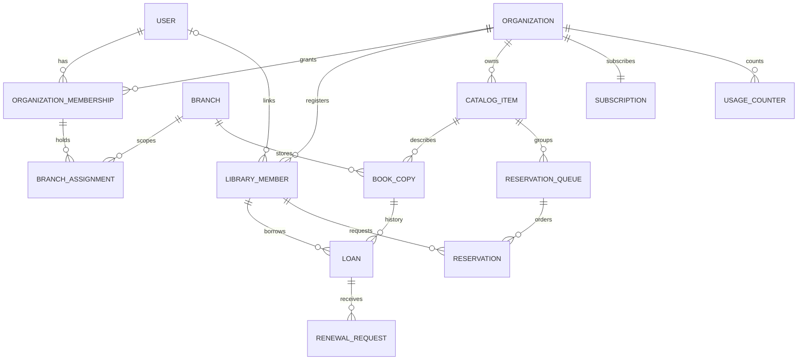
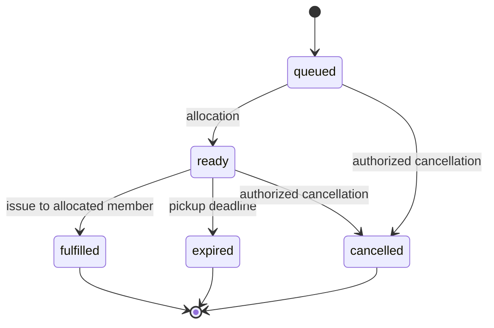
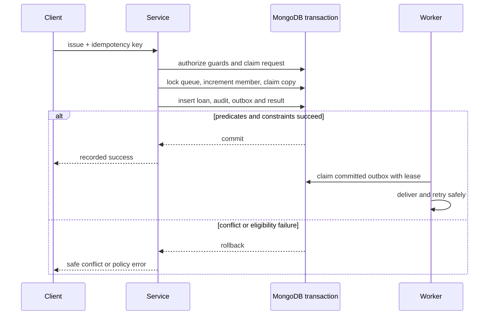

# Database design

Status: design for approval. Source: [SRS.md](SRS.md) and [ARCHITECTURE.md](ARCHITECTURE.md). MongoDB Atlas with Mongoose only. Business decisions D02–D09 remain **PENDING APPROVAL**.

## Conventions and validation

All documents have ObjectId `_id`, UTC `createdAt`/`updatedAt` and a numeric version where conditional updates are required. Tenant documents have immutable `organizationId`. References are ObjectIds, not embedded unbounded histories. List histories through separate collections. MongoDB does not enforce foreign keys: services verify reference existence, tenant equality, branch scope and lifecycle within the transaction where a concurrent change matters.

Validate at request, service and database boundaries. Mongoose schemas reject unknown writable fields; use database JSON Schema validators for required types, enums and numeric bounds. Update paths must run validation and conditional predicates; do not assume a schema validator enforces cross-document rules. Money uses integer minor units plus currency, never floating point. Counts are nonnegative integers; dates must be real timestamps; dueAt must follow issuedAt. Bound string lengths, arrays, page sizes and uploads; concrete security caps are set before implementation and tested. Optional values are omitted rather than mixed null/empty strings. Normalize email, slug and barcode consistently before indexing; email normalization must not apply provider-specific dot/plus rewriting.

## Collections and owned fields

| Collection | Principal fields and constraints |
| --- | --- |
| users (global) | normalizedEmail, passwordHash, verifiedAt?, status, sessionVersion; no organization role |
| sessions (global) | tokenHash, userId, expiresAt, revokedAt?, sessionVersion; never store raw cookie token |
| identityTokens (global) | tokenHash, userId, purpose, expiresAt, consumedAt?; verification/recovery only |
| platformAssignments (global) | userId, role SuperAdmin/PlatformSupport, status, authorizationVersion |
| organizations | name, normalizedSlug, status, timezone, authorizationVersion, operationFence; status and policy changes touch the same guard as critical writes |
| organizationMemberships | organizationId, userId, role Owner/Admin/Librarian/Member, status, capabilityOverrides, authorizationVersion, operationFence |
| branchAssignments | organizationId, membershipId, branchId, status; assignment is access, not a second role |
| branches | organizationId, name, code, status, version |
| invitations | organizationId, normalizedEmail, proposedRole, proposedBranchIds, tokenHash, expiresAt, status, invitedBy |
| libraryMembers | organizationId, userId?, memberNumber, displayName, contact?, category, homeBranchId?, status, validUntil?, activeLoanCount, version |
| catalogItems | organizationId, resourceType physicalBook for MVP, title, isbn?, authors[], publisher?, edition?, publicationYear?, category?, language?, description?, coverAssetId?, keywords[], status |
| bookCopies | organizationId, catalogItemId, branchId, normalizedBarcode, shelfLocation?, acquiredAt?, condition, status, activeLoanId?, heldReservationId?, version |
| transfers | organizationId, copyId, fromBranchId, toBranchId, status, dispatchedAt?, receivedAt?, actorIds, version |
| borrowingPolicies | organizationId, version, scope discriminator and references, effectiveAt, approved configuration; numeric defaults and precedence **PENDING APPROVAL** (D04–D05) |
| loans | organizationId, memberId, copyId, catalogItemId, issueBranchId, returnBranchId?, issuedAt, dueAt, returnedAt?, status, renewalCount, policySnapshot, version |
| reservations | organizationId, catalogItemId, memberId, queueId, sequence, pickupBranchId?, copyId?, status, isOpen, pickupExpiresAt?, fulfilledLoanId?, version |
| reservationQueues | organizationId, catalogItemId, scopeKey, nextSequence, operationFence; scopeKey is populated only after queue-scope decision D04 |
| renewalRequests | organizationId, loanId, memberId, status pending/approved/rejected/cancelled, decisionActor?, proposedDueAt?, version; automatic versus staff approval **PENDING APPROVAL** |
| fineEntries | organizationId, loanId, memberId, kind, amountMinor, currency, policyVersion, reason, reversesEntryId?; posting/waiver/payment rules **PENDING APPROVAL** (D05) |
| plans (global) | code, version, feature flags, limit definitions; immutable published versions; no approved numeric Free thresholds yet |
| subscriptions | organizationId, planId, planVersion, status, entitlementVersion, periodStart?, periodEnd?, provider?, providerCustomerId?, providerSubscriptionId?; one current relationship |
| subscriptionEvents | organizationId, subscriptionId, change, effectiveAt, actorId; history separate from current relationship |
| usageCounters | organizationId, metric, count, entitlementVersion, version; transactional admission counters |
| auditEvents | organizationId for tenant events, actorId or system identity, action, resourceType/id, branchIds[], timestamp, requestId, sanitized change summary; platform-only events have explicit global scope |
| outboxEvents | organizationId, eventType, resourceId, payload with minimal identifiers, status, availableAt, leaseUntil?, leaseToken?, attemptCount, eventKey |
| notifications | organizationId, recipientUserId, eventId, template, safe content, readAt? |
| deliveryAttempts | organizationId, eventId, recipientKey, channel, status, providerId?, retryAt?, sanitizedError? |
| idempotencyRecords | organizationId for tenant requests, actorId, operation, keyHash, requestHash, status, result reference/response, expiresAt |

An authenticated patron has both an active organization membership and a linked libraryMember; branchAssignments apply to staff access only. Patron ownership checks use libraryMember.userId, not staff assignment. Staff/patron coexistence representation remains **PENDING APPROVAL** (D03). No automatic linking by matching contact email.

## Relationships

## Index catalogue

Notation: `U` unique; `P` partial; all listed directions ascending unless `desc`. Built-in `_id` indexes remain. Deploy indexes explicitly, not automatically on production startup. Validate duplicates before adding unique indexes.

| Collection | Indexes and purpose |
| --- | --- |
| users | U(normalizedEmail) |
| sessions, identityTokens | U(tokenHash); (userId); TTL(expiresAt, expireAfterSeconds=0) |
| platformAssignments | U(userId) for one active platform role representation |
| organizations | U(normalizedSlug) |
| organizationMemberships | U(organizationId,userId); (userId,status) for workspace selection |
| branchAssignments | U(organizationId,membershipId,branchId); (organizationId,branchId,status) |
| branches | U(organizationId,code); (organizationId,status,_id) |
| invitations | U(tokenHash); (organizationId,normalizedEmail,status); (expiresAt) for expiry worker |
| libraryMembers | U(organizationId,memberNumber); U(organizationId,userId), P userId has ObjectId type; (organizationId,homeBranchId,status,_id) |
| catalogItems | (organizationId,status,_id); (organizationId,isbn) nonunique; compound text index with organizationId prefix on title/authors/keywords for pilot search |
| bookCopies | U(organizationId,normalizedBarcode); (organizationId,branchId,status,_id); (organizationId,catalogItemId,status) |
| transfers | (organizationId,status,createdAt,_id); U(organizationId,copyId), P status=dispatched |
| borrowingPolicies | U(organizationId,scopeKey,version); (organizationId,scopeKey,effectiveAt desc) |
| loans | U(organizationId,copyId), P status=active; (organizationId,memberId,issuedAt desc,_id); (organizationId,issueBranchId,status,dueAt,_id) |
| reservationQueues | U(organizationId,catalogItemId,scopeKey) |
| reservations | U(organizationId,queueId,sequence); (organizationId,queueId,status,sequence); (organizationId,status,pickupExpiresAt); U(organizationId,copyId), P status=ready; duplicate-member reservation constraint **PENDING APPROVAL** D04 |
| renewalRequests | (organizationId,loanId,status); U(organizationId,loanId), P status=pending |
| fineEntries | (organizationId,memberId,createdAt,_id); (organizationId,loanId) |
| plans | U(code,version) |
| subscriptions | U(organizationId) |
| subscriptionEvents | (organizationId,subscriptionId,effectiveAt desc,_id) |
| usageCounters | U(organizationId,metric) |
| auditEvents | (organizationId,timestamp desc,_id); (organizationId,resourceType,resourceId,timestamp desc) |
| outboxEvents | U(organizationId,eventKey); (status,availableAt,leaseUntil) worker scheduling |
| notifications | U(organizationId,recipientUserId,eventId); (organizationId,recipientUserId,createdAt desc,_id) |
| deliveryAttempts | U(organizationId,eventId,recipientKey,channel); (status,retryAt) |
| idempotencyRecords | U(organizationId,actorId,operation,keyHash); TTL(expiresAt,0); global requests use a separate explicit global scope key |

TTL deletion is asynchronous; always check expiry in application logic. No TTL on loans, audit or patron records until retention approval (D08). Single-field ObjectId lookups still require a tenant predicate. ISBN is optional and not unique: editions and local catalog practices may repeat it. Search must include tenant equality and bounded query length; benchmark text search before selecting another engine. Optional branch-filter report indexes are added based on query plans, not speculative indexing.

## Loan, copy and reservation lifecycles

Loan states: `active -> returned`. Overdue is derived from active plus dueAt < now, not another stored state. Renewal retains active and increments renewalCount with a due-date change. Lost/damaged closure, cancellation and correction states are **PENDING APPROVAL** (D05); do not silently make copies available through these paths.

Copy states: available, onLoan, held, inTransit, unavailable, withdrawn. Condition is a separate descriptive field. Only available copies, or held copies allocated to that borrower, may issue. Rules mapping damage/condition to unavailable are **PENDING APPROVAL**. Transfer dispatch changes available to inTransit; receipt changes to available or unavailable after inspection. Transfer permissions and cancellation rules remain **PENDING APPROVAL** D04.

queued/ready set isOpen=true; terminal states set false. Queue sequence is monotonic per queue; allocate by sequence among eligible queued entries. Fairness exceptions, duplicate title requests, cancellation eligibility, queue scope and pickup deadlines are **PENDING APPROVAL** D04–D05. These states describe the mechanism without choosing those rules. Expiry releases a hold transactionally and triggers allocation; it does not delete history. Never use TTL to advance lifecycle states.

## Transaction and concurrency protocol

Use a replica-set-capable Atlas deployment, a single Mongoose session per transaction and majority commit durability. Keep operations sequential within a transaction. Bounded driver-supported retries handle transient failures; retry unknown commit outcomes using the driver's commit behavior and resolve via idempotency records. External calls occur after commit.

Critical operations touch a shared organization operationFence with an active-state predicate, and the actor membership fence with active/version predicates. Suspension and permission/assignment mutations touch the same records, serializing relevant revocation with mutations. Sensitive global account/platform changes likewise update a user/platform guard checked by the operation. This deliberately favors clear correctness over high pilot throughput; readers reauthorize but do not all take write guards. A request serialized before revocation can complete; a later one must fail.

### Issue

1. Validate identifiers and body, resolve tenant/actor, require circulation.issue and issuing branch assignment; require an Idempotency-Key scoped to actor, tenant and operation.
2. In one transaction, reserve the unique idempotency record; same key with different requestHash is a conflict. Touch authorization guards. Validate member status/validity, policy version, copy ownership/branch and active subscription rules.
3. Touch the title queue guard even when the queue is empty. Reservation creation, cancellation, allocation and issue share it, preventing an issue from overtaking a concurrently created reservation. Derive queue scope only after D04 approval.
4. Increment member.activeLoanCount using a predicate count < configured limit and version; updates to member eligibility also touch this member record. A separate-copy simultaneous loan then conflicts or hits the limit.
5. Conditionally change copy from available, or held for this member's ready reservation, to onLoan with activeLoanId. Reject other states. Insert active loan; unique active-copy index is a second invariant.
6. Fulfill a matching reservation, snapshot the effective borrowing policy, insert audit/outbox events, and store the success result in the idempotency record. Commit together. Any failure rolls everything back.

### Return

1. Require circulation.return and branch permission. Cross-branch return eligibility is **PENDING APPROVAL** D04; a route must not imply it is allowed.
2. In one transaction, reserve/replay idempotency, touch guards, conditionally update only an active loan to returned and record actual return timestamp/branch.
3. Match copy.activeLoanId to that loan and status=onLoan; decrement member.activeLoanCount with count > 0. A mismatch aborts and raises an integrity alert, rather than repairing silently.
4. Under the same title queue guard, evaluate approved fine policy and eligibility. Append fine entries when enabled. Allocate the copy to the next eligible reservation as held, or release as available/unavailable according to inspection. If inspection/allocation rules are unconfigured, reject the unsupported path before any mutation; do not guess policy.
5. Insert audit and outbox events and idempotency result. Commit. Repeating the same return does not decrement twice or create duplicate fines; an already returned loan with another key returns its recorded state without new effects.

### Renewal and allocation

Condition renewal on active loan, expected version, approved renewal limit and queue eligibility while holding the same member/copy/title guards. Record the policy snapshot and audit; do not extend from a stale due date. Staff approval versus automatic eligibility is **PENDING APPROVAL** D05. Allocation and expiry use version/expected-state predicates so only one worker can transition a reservation or hold a copy. Return, renewal and expiry races serialize on these records.

## Subscription admission and reconciliation

Create organization, Owner membership, current Free subscription and initial counters atomically. Store versioned plan entitlements; do not hardcode the unapproved 1/500/2/100 proposal. A resource-creating service checks its capability and feature flag, then conditionally increments the organization metric counter with count + delta <= approved limit in the same transaction as insertion. For unlimited metrics, still record count. Plan changes and admission share a subscription/entitlement guard so a concurrent downgrade cannot be missed.

Counter metric definitions (whether invited staff, archived patrons or withdrawn copies count) and downgrade behavior are **PENDING APPROVAL** D06. Do not enable admissions dependent on unconfigured limits. Delete/archive/reactivate/accept-invitation paths apply exactly the approved metric delta once; all imports and worker paths use the same service. Subscription changes never delete data. Reconcile counters with source collections using a consistent snapshot and version-checked correction under the admission guard; do not overwrite concurrent increments. Inventory display always derives from copies.

## Technical references

The conditional-write and transaction strategy follows MongoDB's [atomicity guidance](https://www.mongodb.com/docs/manual/core/write-operations-atomicity/). Review [transaction production considerations](https://www.mongodb.com/docs/manual/core/transactions-production-consideration/) when choosing deployment and retry settings. These technical mechanisms do not resolve LibraryOS business decisions.
