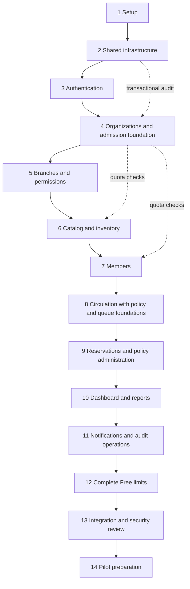

# LibraryOS implementation roadmap

Status: roadmap approved for implementation; Task 1.1 was completed and the user authorized continuation to **Phase 1, Task 1.2 only**. Task 1.3 and later tasks require confirmation. Work one small task at a time. No commit or push is authorized; a task being ready to commit does not authorize a commit.

## Sources and technical review

Reviewed [SRS](SRS.md), [architecture](ARCHITECTURE.md), [database](DATABASE_DESIGN.md), [permissions](PERMISSIONS.md), [API design](API_DESIGN.md) and [security](SECURITY.md). Requirements remain unchanged. Decision IDs refer to the architecture register; unresolved business rules remain **PENDING APPROVAL**.

Resolve these design details before affected implementation tasks:

- Policies describe scope fields but index scopeKey: define its canonical derivation before deploying the schema. Policy precedence remains PENDING APPROVAL D04–D05.
- Specify explicit global idempotency scope/indexes rather than relying on nullable organizationId.
- Align User/platform guard fields with the transaction protocol before sensitive writes.
- Permission defaults, role coexistence and support powers are still proposals. Unapproved access stays denied.
- Ownership transfer, subscription administration, fine settlement, support inspection and export/deletion contracts need decision approval and API review before implementation.

## Order and early prerequisites

Keep the requested 14-phase order. Architecture requires three foundations earlier than their full user-facing phases:

1. Phase 2 persists audit/outbox events; sensitive mutations use them immediately. Phase 11 completes delivery and audit browsing.
2. Phase 4 bootstraps subscriptions/admission. Each counted-resource phase enforces its quota before enabling creation. Phase 12 completes Free configuration, visibility and reconciliation. Missing limits never mean unlimited.
3. Phase 8 first builds policy evaluation and queue guards. Phase 9 completes reservations, expiry and policy administration. Real circulation waits for their combined release gate.

## Working rules

Paths below are repository-relative planned files; only the currently authorized task is implemented. `T` means `/api/v1/organizations/{organizationId}`. Tenant Route Handlers belong under `src/app/api/v1/organizations/[organizationId]/`; other API files under `src/app/api/v1/`. Use module model/validation/service/focused repository files without unnecessary abstractions.

Each checklist task is an independent review/commit-sized slice including tests. Services can be tested before an endpoint/UI is enabled. Never enable a path bypassing unfinished prerequisites. Split any task too large for one focused review. No schedule is promised while approvals remain open.

Common gate per task: focused diff, appropriate passing tests, no secret/tenant leakage, recorded acceptance evidence and no unrelated changes. At every phase boundary, report evidence/blockers and propose the next task; wait for approval before the next major phase. All checkboxes start unchecked.

## Phase 1 — Project setup and development environment

**Objective:** Establish reproducible local development and an understandable skeleton.

**Features to implement:** Next.js App Router, TypeScript, Tailwind, shadcn/ui, Motion, Vitest/Playwright foundation; responsive accessible shell with forest green, antique gold and ivory tokens.

**Required folders and files:** `package.json`, lockfile, `tsconfig.json`, `next.config.ts`, lint config, `vitest.config.ts`, `playwright.config.ts`, `.gitignore`, `.env.example`, `README.md`, `src/app/{layout.tsx,page.tsx,globals.css}`, `src/components/ui/`, `tests/`. Select compatible supported versions when implementation is authorized.

**Dependencies:** Roadmap/phase approval; hosting-specific decisions D09 can wait for affected configuration.

**Database models:** None.

**APIs:** None; no public registration or tenant operation.

**Business logic:** None; establish module ownership and imports only.

**Security checks:** Ignore secrets; no real credentials in examples; server/client boundary and dependency provenance review.

**Testing requirements:** Type/lint/build, test-runner verification, shell browser smoke; keyboard/focus/contrast/reduced-motion checks.

**Acceptance criteria:** Documented clean install builds/starts/runs checks; no domain implementation bundled into setup.

**Small tasks and completion checklist:**

- [x] 1.1 Scaffold runtime/configuration and documented commands; verify build.
- [x] 1.2 Configure isolated test runners and shell smoke flow.
- [ ] 1.3 Add shell/tokens and accessibility review.
- [ ] 1.4 Review dependencies/environment and record phase acceptance.

### Task 1.1 implementation evidence — October 19, 2026

Implemented only the Next.js App Router runtime, strict TypeScript configuration, ESLint configuration, pinned npm manifest/lockfile, secret/generated-file ignores, empty environment template, Node version file and local command documentation. The startup page and CSS are minimal build fixtures; visual design integration remains Task 1.3. Next.js maintains ignored `next-env.d.ts` and generated route types.

Validation on Node 24.18.0/npm 11.16.0:

- `npm install`: passed and generated `package-lock.json`; `npm ls --depth=0`: passed with pinned direct dependencies and no invalid peer tree.
- `npm run lint`: passed with zero warnings.
- `npm run typecheck`: passed, including Next.js route type generation and strict TypeScript.
- `npm run build`: passed with Turbopack; root page prerendered successfully.
- Production startup/HTTP smoke check on loopback port 3100: passed; root HTTP 200 with expected title, h1 and English language; no X-Powered-By header; `/api/v1/organizations` returns 404. Temporary server stopped afterward.
- `npm audit --omit=dev`: zero reported runtime findings. Full audit: five high-severity affected packages from one unpatched braces advisory in the development lint chain. ESLint 9 deprecation remains because several current Next.js lint plugins do not declare ESLint 10 compatibility. Details and advisory link are in README.md. No forced incompatible remediation or security waiver was applied.
- SRS SHA256 remains `A8E0C275802A132C3AF820DDA58B9DDEC8B5BCB2E2D1D7C8796E081B6D084552`.

No test runner/browser suite was configured: that is Task 1.2. No protected data, API, authentication stub, database connection or business workflow exists. The task is implemented with the tooling findings recorded above; user confirmation is still required before Task 1.2. No commit or push was made.

### Task 1.2 implementation evidence — October 19, 2026

Added Vitest 5.0.5 and Playwright 1.64.1 as pinned development dependencies; updated the lockfile and scripts. Vitest discovers only `tests/unit/**/*.test.ts(x)` in Node with explicit test imports, a source alias and restored mocks. Playwright discovers only `tests/e2e/**/*.spec.ts`, uses fresh Chromium contexts, rejects focused tests and owns a production server on loopback port 3101 with server reuse disabled. Package module format is explicitly ESM to match source/config imports and remove Vite's native-loader compatibility warning.

Validation:

- `npm test`: one unit smoke test passed, rendering the real synchronous startup component through the alias/TSX pipeline.
- `npm run lint`: passed with zero lint warnings.
- `npm run typecheck`: passed after the ESM configuration change.
- `npm run test:e2e`: production build and both Chromium tests passed: startup HTML/title/language/visible heading without browser errors, plus unknown-route 404. The runner stopped its server afterward. Browser execution required permission outside the sandbox for local sockets/processes; application settings were not weakened.
- Chromium was installed in Playwright's local cache. No browser binaries or generated test artifacts are source files.
- `npm ls --depth=0`: passed with no invalid direct dependency tree. Installation still reports the five existing development lint-chain findings recorded under Task 1.1; no force-fix was applied.

Updated README.md and tests/README.md with commands, runner boundaries, dedicated port, artifact handling and environment limitations. Browser tests inherit local environment; no database/provider is configured, and Phase 2 still needs disposable database safeguards. This setup is not a claim of production data isolation or cross-browser coverage.

Task 1.3 remains unchecked and requires confirmation. No application UI/domain behavior or approved requirements changed; no commit or push was made.

## Phase 2 — Database connection and shared infrastructure

**Objective:** Make future operations scoped, transactional, observable and retry-safe.

**Features to implement:** Pooled Mongoose connection, validated environment, transactions, tenant-required access conventions, typed errors/DTOs, request IDs, idempotency and transactional audit/outbox helpers.

**Required folders and files:** `src/server/config.ts`, `src/server/db/{connection,transaction}.ts`, `src/server/http/{errors,responses,pagination}.ts`, `src/server/logging.ts`, `src/server/idempotency/{model,service}.ts`, `src/modules/audit/{model,append}.ts`, `src/modules/notifications/{outbox-model,publish}.ts`, `scripts/db/{indexes,validators}.ts`, `tests/integration/helpers/`, `docs/DEVELOPMENT.md`.

**Dependencies:** Phase 1; isolated transaction-capable MongoDB. Resolve global-idempotency/guard review findings. D09 before provisioning hosted infrastructure.

**Database models:** IdempotencyRecord, AuditEvent, OutboxEvent. Explicit index/validator deployment, no automatic production synchronization.

**APIs:** Shared response/error layer only. Readiness checks reveal no secrets/topology; no public database diagnostic endpoint.

**Business logic:** Shared transaction context, bounded retries, same key/body replay and changed-body conflict. Audit/outbox commit with domain effects; external delivery stays outside transactions/retry callbacks.

**Security checks:** Least-privilege DB/TLS, redaction, mandatory tenant predicates with explicit global exceptions and bounded input.

**Testing requirements:** Real MongoDB rollback, duplicate/validator enforcement, replay/conflict, transient/ambiguous outcomes and outbox visibility after commit. Reject omitted scope and prevent tests targeting production.

**Acceptance criteria:** Failed transactions leave no partial state; errors/logs are safe; persistence works without real email delivery.

**Small tasks and completion checklist:**

- [ ] 2.1 Add configuration/connection and isolated database fixtures.
- [ ] 2.2 Add error/DTO/pagination/logging conventions and tests.
- [ ] 2.3 Add transactions/scoped access and rollback tests.
- [ ] 2.4 Add audit/outbox models and atomic append tests.
- [ ] 2.5 Add idempotency and explicit index/validator deployment checks.

## Phase 3 — Authentication and secure sessions

**Objective:** Provide global identity without embedding tenant privileges in login.

**Features to implement:** Approved registration/activation, hashing, login/logout, opaque sessions, verification/recovery and own-account views. Development delivery adapter until phase 11 real email approval.

**Required folders and files:** `src/modules/auth/{user-model,session-model,identity-token-model,validation,passwords,sessions,service}.ts`, `src/server/security/{csrf,rate-limit}.ts`, `src/app/api/v1/auth/**/route.ts`, `src/app/api/v1/me/route.ts`, `src/app/(auth)/`, `tests/integration/auth/`, `tests/e2e/auth.spec.ts`.

**Dependencies:** Phase 2. Activation/password/session defaults **PENDING APPROVAL** D02; distributed rate-limit implementation/thresholds and registration availability **PENDING APPROVAL** D09. Incomplete flows stay disabled.

**Database models:** User, Session, IdentityToken; normalized email/token uniqueness and expiry indexes. Check expiry independently of TTL cleanup.

**APIs:** POST auth register/login/logout/verification-requests/verify-email/password-reset-requests/reset-password; GET/PATCH `/api/v1/me`, using exact contracts in API_DESIGN.md.

**Business logic:** Normalize email without provider-specific rewriting, verify Argon2id hash, rotate/revoke sessions, consume purpose-bound tokens once and revoke after reset. No automatic patron linking.

**Security checks:** Benchmark hash settings, secure HttpOnly cookies, CSRF/Origin checks, shared limits, generic enumeration-resistant responses and approved sensitive-edit reauthentication.

**Testing requirements:** Duplicate email, invalid credentials, cookie flags, expiry/revocation, token replay/wrong purpose, CSRF, enumeration and DTO/log redaction.

**Acceptance criteria:** Only token hashes persist; reset/logout revoke correctly; no supplied role grants tenant access.

**Small tasks and completion checklist:**

- [ ] 3.1 Add identity schema/hashing and uniqueness tests.
- [ ] 3.2 Add sessions, CSRF and distributed limiter integration.
- [ ] 3.3 Add login/logout API and browser flow.
- [ ] 3.4 Add approved activation/recovery with development delivery.
- [ ] 3.5 Add own-profile edits and authentication security review.

## Phase 4 — Organizations and memberships

**Objective:** Establish tenant isolation and atomic Owner onboarding.

**Features to implement:** Workspace creation/selection, memberships, unique slugs, trusted tenant context, suspension guards, Free subscription bootstrap and quota admission foundation.

**Required folders and files:** `src/modules/organizations/{model,validation,service,repository}.ts`, `src/modules/staff/membership-model.ts`, `src/modules/subscriptions/{plan-model,subscription-model,usage-model,admission}.ts`, `src/server/auth-context.ts`, organization/me-organizations route files, `src/app/(workspace)/`, `tests/integration/organizations/`.

**Dependencies:** Phase 3; Owner rules D03, Free/counting D06 and creation policy D09 **PENDING APPROVAL**. Real admissions remain disabled until configured; test fixtures are explicitly nonproduction.

**Database models:** Organization, OrganizationMembership, Plan, Subscription, UsageCounter; one membership per user/tenant and one current subscription.

**APIs:** POST `/api/v1/organizations`; GET `/api/v1/me/organizations`; GET/PATCH T. Platform suspension API waits for phase 13/D07.

**Business logic:** Atomically create organization, Owner membership, Free relationship and counters. Resolve scope from membership. Add conditional admission/entitlement guard; later phases wire each metric. Preserve records on subscription change.

**Security checks:** No foreign workspace selection, slug privilege or client-role escalation; organization/membership guards serialize sensitive writes with revocation/suspension.

**Testing requirements:** Onboarding rollback, duplicate slug, workspace role isolation, suspended/inactive membership, foreign IDs and admission replay/rollback.

**Acceptance criteria:** No orphan records; workspace switching clears previous UI data; future tenant services require trusted scope; missing limit never implies unlimited.

**Small tasks and completion checklist:**

- [ ] 4.1 Add organization/membership models and tenant-context tests.
- [ ] 4.2 Add plan/subscription/counter models and admission primitive.
- [ ] 4.3 Add atomic idempotent onboarding service/API.
- [ ] 4.4 Add workspace selection/settings and suspension-guard tests.
- [ ] 4.5 Validate approved bootstrap/counting before enabling onboarding.

## Phase 5 — Branches and permissions

**Objective:** Enforce fixed roles, bounded customization and branch scope.

**Features to implement:** Branches, assignments, capability evaluation, invitations/acceptance and Owner/version-guard protection.

**Required folders and files:** `src/modules/branches/{model,validation,service}.ts`, `src/modules/staff/{assignment-model,invitation-model,service}.ts`, `src/modules/permissions/{capabilities,evaluate,guards}.ts`, branches/staff/invitations route files, `src/app/api/v1/invitations/accept/route.ts`, workspace staff/branch pages, `tests/integration/permissions/`.

**Dependencies:** Phase 4. Defaults/ceilings/Owner powers/coexistence **PENDING APPROVAL** D03; branch/staff counting D06. Real invitation delivery completes phase 11; never log raw tokens as a temporary delivery channel.

**Database models:** Branch, BranchAssignment, Invitation; membership guards and usage counters.

**APIs:** GET/POST T/branches, GET/PATCH branch detail, GET T/staff, POST T/invitations, POST global invitations/accept, PATCH staff and PUT branch-assignments/capabilities.

**Business logic:** Capability AND scope, deny precedence, delegation ceiling, verified invitation recipient, atomic acceptance/assignments/quota and last-Owner invariant. Branch creation increments quota in the insertion transaction.

**Security checks:** Foreign assignments rejected; no self-escalation or Admin Owner grant; assignment changes touch shared guards; no undocumented Owner branch bypass.

**Testing requirements:** Role/scope matrix, revoked assignments, acceptance replay/race, staff/branch caps, simultaneous last-Owner removal and stale authorization writes.

**Acceptance criteria:** Backend-authorized/audited branch/staff operations; acceptance cannot duplicate membership or bypass caps.

**Small tasks and completion checklist:**

- [ ] 5.1 Add capability evaluator and table-driven tests.
- [ ] 5.2 Add branch API/UI with quota/tenant tests.
- [ ] 5.3 Add assignments/bounded edits and revocation tests.
- [ ] 5.4 Add invitation/acceptance and transactional events.
- [ ] 5.5 Finish staff UI and Owner protection review.

## Phase 6 — Book catalog and inventory

**Objective:** Separate organization-wide titles from branch-owned physical stock.

**Features to implement:** Catalog/search, optional ISBN, copies/barcodes, separate conditions/statuses, adjustments, covers and approved transfers.

**Required folders and files:** `src/modules/catalog/{model,validation,service,search}.ts`, `src/modules/inventory/{copy-model,transfer-model,service,transfers}.ts`, `src/modules/media/{validation,cloudinary,service}.ts`, catalog/copies/transfers/media route files, workspace catalog/inventory pages, `tests/integration/inventory/`.

**Dependencies:** Phase 5; transfer D04, condition behavior D05, copy counting D06 and media D08 **PENDING APPROVAL**. A blocked transfer decision does not prevent independent catalog metadata work.

**Database models:** CatalogItem, BookCopy, Transfer; organization barcode uniqueness, tenant-prefixed search and one dispatched transfer per copy.

**APIs:** GET/POST catalog/copies, GET/PATCH details, POST copy adjustments, POST transfers/receive and upload-authorizations/upload-completions under T.

**Business logic:** Optional nonunique ISBN; inventory totals derive from copies. Copy creation consumes quota. Metadata edits cannot issue/return. Transfer dispatch/receipt is transactional under approved states and both-branch authorization. Archive/withdraw deltas follow approved counting rules.

**Security checks:** Same-tenant references, branch-filtered availability, allowlisted fields, scoped upload signatures/content verification and no arbitrary provider asset mutation.

**Testing requirements:** Barcode unique within organization but reusable in another, multi-branch stock, unavailable states, quota race, unauthorized/concurrent transfer, forged upload completion and bounded search/query plans.

**Acceptance criteria:** Catalog edits cannot move copies or alter loans; transfers cannot duplicate stock; covers cannot bind across tenants; totals reconcile with copies.

**Small tasks and completion checklist:**

- [ ] 6.1 Add catalog schema/search/read API with tenant tests.
- [ ] 6.2 Add catalog editing/forms and audit tests.
- [ ] 6.3 Add copies/metadata with quota/barcode tests.
- [ ] 6.4 Add approved adjustments/transfers and state/branch tests.
- [ ] 6.5 Add constrained cover uploads/cleanup and accessible inventory UI.

## Phase 7 — Members

**Objective:** Manage patrons separately from global login and staff access.

**Features to implement:** Registration/search/edit, categories/home branch, eligibility/validity, optional verified account link and own-member view.

**Required folders and files:** `src/modules/members/{model,validation,service,account-linking}.ts`, member/me-member/account-invitation route files, workspace member pages, `tests/integration/members/`, `tests/e2e/member-access.spec.ts`.

**Dependencies:** Phase 6; claiming D02, coexistence D03, visibility D04, validity D05 and counted member states D06 **PENDING APPROVAL**.

**Database models:** LibraryMember; organization memberNumber uniqueness, optional-user partial uniqueness and nonnegative activeLoanCount. Reuse token mechanisms only with explicit purpose/ownership.

**APIs:** GET/POST T/members, GET/PATCH member detail, POST account-invitations, GET T/me/member. Loan history is wired in phase 8.

**Business logic:** Staff create unlinked patrons; matching email never proves account ownership. Claim atomically verifies identity/uniqueness/organization access. Creation/reactivation uses approved quota deltas. Eligibility updates share the member record used by circulation counters.

**Security checks:** Contact redaction, approved home-branch visibility, own-link checks, no arbitrary userId reassignment or editable activeLoanCount.

**Testing requirements:** Linked/unlinked patrons, foreign home branch, competing claims, wrong-user access, duplicate memberNumber, validity boundaries and quota race.

**Acceptance criteria:** Unlinked patrons can be managed; self-service resolves only verified links; patron records and staff assignments are never mistaken for global identity.

**Small tasks and completion checklist:**

- [ ] 7.1 Add patron schema/registration/search and quota tests.
- [ ] 7.2 Add approved eligibility/validity edits with version guards.
- [ ] 7.3 Add claim/self-view services and negative tests.
- [ ] 7.4 Add accessible member UI and personal-data response review.

## Phase 8 — Borrowing, returns and renewals

**Objective:** Build concurrency-safe physical circulation without bypassing queue or policy rules.

**Features to implement:** Policy evaluator prerequisite, title queue guards, issue/return, derived overdue, renewal requests/decisions, configured fines and staff/member loan views.

**Required folders and files:** `src/modules/policies/{model,resolve,evaluate}.ts`, `src/modules/reservations/{queue-model,model,guard,allocation}.ts`, `src/modules/circulation/{loan-model,renewal-model,issue,return,renew,validation}.ts`, `src/modules/fines/{model,calculate,append}.ts`, loan/renewal/me-loan route files, workspace circulation pages, `tests/integration/circulation/`.

**Dependencies:** Phase 7. Queue/return/allocation D04 and policy/calendar/fine/renewal D05 **PENDING APPROVAL**. Phase 9 is a combined release dependency. No real issue/return endpoint uses placeholder policies.

**Database models:** Loan, RenewalRequest, FineEntry, BorrowingPolicy, ReservationQueue, Reservation; active-loan and pending-renewal partial uniqueness. Resolve canonical scopeKey before policy/queue schema deployment.

**APIs:** GET/POST T/loans, GET detail, POST return, POST renewal-requests/decision, GET T/me/loans. Fine read/adjustment only with approved D05 contracts.

**Business logic:** One transaction claims idempotency, touches authorization/entitlement/queue guards even with an empty queue, conditionally increments member count, claims copy and inserts loan/audit/outbox/result. Return verifies activeLoanId, closes/decrements once, applies approved fines and allocates/releases under queue guard. Renewal checks active version/limit/queue. Overdue is derived.

**Security checks:** Physical actions staff-only; branch/member/reference checks; no direct lifecycle PATCH or client due-date/fine override; reauthorize replay.

**Testing requirements:** Same-copy competing issues; same-member different-copy limit race; duplicate returns; renewal/return and issue/enqueue races; failure after each write; ambiguous commit; copy/loan mismatch alert; policy-not-configured rejection.

**Acceptance criteria:** At most one active loan per copy; no negative member count/double fine; no partial effects. Real circulation remains unreleased until phase 9 integration passes.

**Small tasks and completion checklist:**

- [ ] 8.1 Add approved policy evaluator, queue/allocation interfaces and schemas.
- [ ] 8.2 Add issue transaction and parallel-copy/member-limit tests.
- [ ] 8.3 Add return transaction and replay/rollback/fine tests.
- [ ] 8.4 Add renewal requests/decisions and race tests.
- [ ] 8.5 Add loan API/UI behind release gate and record phase 9 dependency.

## Phase 9 — Reservations and borrowing policies

**Objective:** Complete policy administration and ordered reservations before real circulation release.

**Features to implement:** Versioned policies, title queues, pickup holds, cancellation, fulfillment, expiry and member reservation UI.

**Required folders and files:** `src/modules/policies/{validation,service}.ts`, `src/modules/reservations/{validation,service,expiry}.ts`, `src/workers/reservation-expiry.ts`, policy/reservation route files, workspace policy/member reservation pages, `tests/integration/reservations/`.

**Dependencies:** Phase 8 foundations; queue scope/fairness/duplicates/cancellation D04 and pickup/defaults D05 **PENDING APPROVAL**. Deployed expiry scheduling needs D09.

**Database models:** Complete existing BorrowingPolicy, ReservationQueue and Reservation, not competing models. queued/ready are open; fulfilled/cancelled/expired retain terminal history.

**APIs:** GET/POST T/policies, GET/POST T/reservations, POST cancellation. No unauthenticated expiry endpoint.

**Business logic:** Transactional sequence allocation; eligible entries in approved order; one ready hold per copy; issue fulfills hold; expiry/cancel releases/reallocates with expected-state updates. No TTL lifecycle deletion. New policy versions preserve historical loan snapshots.

**Security checks:** Own reservation, approved pickup scope, no queue jumping, scoped worker identity and conditional transitions.

**Testing requirements:** Ordering, duplicate/cancellation rules, parallel expiry/allocation, issue versus enqueue/expiry, policy versus circulation and reserve -> hold -> issue -> return browser flow.

**Acceptance criteria:** Combined phases 8–9 gate passes; no issuing another borrower's held copy or skipping queue rules; missing configuration fails clearly.

**Small tasks and completion checklist:**

- [ ] 9.1 Add immutable policy administration/API/UI and version tests.
- [ ] 9.2 Add enqueue/list/cancel services and self APIs.
- [ ] 9.3 Add allocation/expiry worker with scoped scheduling/concurrency tests.
- [ ] 9.4 Add reservation UI and combined circulation race suite.
- [ ] 9.5 Record combined release acceptance and request approval.

## Phase 10 — Dashboard and reports

**Objective:** Show useful operational data without tenant/branch leakage.

**Features to implement:** Role dashboards; inventory summary, circulation, overdue, member activity and popular books; date/branch filters and Recharts views.

**Required folders and files:** `src/modules/reports/{validation,scope,inventory,circulation,overdue,members,popular,dashboard}.ts`, dashboard/report route files, workspace dashboard/report pages, `src/components/reports/`, `tests/integration/reports/`.

**Dependencies:** Phase 9. Ambiguous popularity/member-activity metrics/date definitions **PENDING APPROVAL** D05/D09. Export subject to D08.

**Database models:** Read existing collections. Add indexes from measured query plans; no new analytics datastore by default.

**APIs:** GET T/dashboard; GET T/reports/{reportType} with approved from/to/branchIds. Member dashboard contains own data only.

**Business logic:** Totals derive from copies/loans; overdue from active due dates; scoped joins, stable pagination and approved local-date conversion. Document metric meaning/freshness.

**Security checks:** Reject unauthorized branches; prevent restricted totals/contact leaks and cross-tenant cache reuse. Catalog visibility does not grant all-stock visibility.

**Testing requirements:** Fixtures for five reports, date/empty boundaries, tenant/branch denial, query plans and accessible chart text alternatives.

**Acceptance criteria:** Totals reconcile with approved metric definitions; filters match actor scope; performance measured under documented conditions.

**Small tasks and completion checklist:**

- [ ] 10.1 Confirm metrics and add shared filter/scope tests.
- [ ] 10.2 Add inventory report and fixture tests.
- [ ] 10.3 Add circulation/overdue reports and boundary tests.
- [ ] 10.4 Add member-activity/popular-book reports and leakage tests.
- [ ] 10.5 Add dashboards/charts and accessibility/performance review.

## Phase 11 — Notifications and audit logs

**Objective:** Complete reliable delivery and protected visibility over persisted events.

**Features to implement:** In-app inbox, email adapter/templates, outbox leasing/retries, failed-delivery operations and audit browsing.

**Required folders and files:** `src/modules/notifications/{notification-model,delivery-model,email,templates,delivery,inbox}.ts`, `src/modules/audit/{query,validation}.ts`, `src/workers/{outbox,notification-retry}.ts`, inbox/audit route files, workspace inbox/audit pages, `tests/integration/notifications/`.

**Dependencies:** Phase 10; phase 2 persistence already covers sensitive mutations. Provider/consent/retention D08 and worker operation D09 **PENDING APPROVAL**. Earlier auth/invitation events now use approved real delivery.

**Database models:** Notification, DeliveryAttempt; complete OutboxEvent lease/query fields and AuditEvent indexes. No history TTL before approved retention.

**APIs:** GET T/notifications; POST notification read; GET T/audit-events. No public audit mutation or arbitrary email-send endpoint.

**Business logic:** Atomic leases/holder tokens, retry caps/backoff, event-recipient-channel deduplication and crash recovery. External delivery is at-least-once; send/ack crashes can duplicate email without provider idempotency. Never undo circulation for delivery failure.

**Security checks:** Recipient ownership, scoped workers, protected audit reads, minimal payloads and no raw invitation/recovery tokens in logs.

**Testing requirements:** Provider outage, crash after send, expired/competing leases, retry cap, duplicates, inbox denial, audit redaction and sensitive-event coverage across earlier modules.

**Acceptance criteria:** Successful operations survive email outages; failed/stuck work is recoverable; no silent loss or unsupported exactly-once promise.

**Small tasks and completion checklist:**

- [ ] 11.1 Add inbox model/API/UI and recipient/deduplication tests.
- [ ] 11.2 Add approved email adapter/templates and test-recipient isolation.
- [ ] 11.3 Add durable delivery/retry worker with crash/lease tests.
- [ ] 11.4 Add audit queries/UI and event coverage/redaction review.

## Phase 12 — Free subscription limits

**Objective:** Complete and verify organization-wide entitlements already enforced by resource services.

**Features to implement:** Published Free configuration, subscription/usage views, approved counted-state deltas, reconciliation and over-limit messaging; future billing seams only.

**Required folders and files:** `src/modules/subscriptions/{validation,entitlements,service,reconcile,event-model}.ts`, subscription/usage route files, workspace subscription page, `scripts/db/reconcile-usage.ts`, `tests/integration/subscriptions/`. Reuse phase 4 admission/models, not a second limiter.

**Dependencies:** Phase 11; limits/counting/features/downgrade **PENDING APPROVAL** D06. Proposed 1 branch/500 copies/2 staff/100 members remains unapproved.

**Database models:** Complete Plan, Subscription, UsageCounter and SubscriptionEvent; immutable entitlement versions and one current relationship.

**APIs:** GET T/subscription; GET T/usage. Changing subscription contracts awaits D06 review; no automated payments or raw card storage.

**Business logic:** Audit every create/archive/reactivate/invite path; atomically apply resource/metric deltas. Plan changes share entitlement guard. Reconcile consistent source snapshot with version-checked correction, never overwrite live increments. Preserve data on limit reduction.

**Security checks:** Protected subscription permission, no client counter/plan tampering; document future signed-webhook boundary without implementing billing.

**Testing requirements:** Concurrent growth at cap, retry/rollback, invitation counting, multi-branch totals, reconcile/admission and downgrade/mutation races, no automatic deletion.

**Acceptance criteria:** Every counted path uses admission; no absent-limit unlimited fallback; counters reconcile; UI explains approved restrictions.

**Small tasks and completion checklist:**

- [ ] 12.1 Validate approved plan configuration/metric definitions.
- [ ] 12.2 Audit existing create/status paths for admission coverage.
- [ ] 12.3 Add subscription/usage API/UI and permission tests.
- [ ] 12.4 Add version-safe reconciliation and quota/downgrade race suite.

## Phase 13 — Integration testing and security review

**Objective:** Prove complete MVP isolation/correctness/operability and finish explicit pilot platform controls.

**Features to implement:** Integrated journeys, hardening, performance/recovery evidence and approved minimal Super Admin organization listing/suspension. Platform controls are a separate slice here because the requested order has no platform phase; they must precede pilot.

**Required folders and files:** `tests/integration/{tenant-isolation,concurrency,recovery}/`, `tests/e2e/`, `src/modules/platform/{assignment-model,validation,service}.ts`, `src/app/api/v1/platform/organizations/route.ts`, platform suspension route, `docs/{SECURITY_REVIEW,PERFORMANCE_RESULTS,RESTORE_DRILL}.md`, CI configuration after provider selection D09. Do not assume an existing remote/provider.

**Dependencies:** Phases 1–12; platform powers/provisioning D07 and recovery/load criteria D09 **PENDING APPROVAL**. This consolidates evidence; earlier integration/security tests are not deferred until here.

**Database models:** PlatformAssignment, platform-scoped audit and production-equivalent validators/indexes on existing models. No generic tenant-bypass model.

**APIs:** GET `/api/v1/platform/organizations`; POST `/api/v1/platform/organizations/{id}/suspend` after D07. Exercise existing REST catalogue; no implicit impersonation API.

**Business logic:** Scoped platform lifecycle, guard-protected suspension, safe restore/reconciliation and incident handling. Fix each discovered defect in a focused regression-tested patch.

**Security checks:** CSRF, session/token revocation, XSS/NoSQL/SSRF/upload abuse, secret/dependency scanning, escalation, support denial and DTO/log redaction. Platform role does not imply tenant membership.

**Testing requirements:** Multiple-tenant/branch negatives; staff/member end-to-end flows; concurrency/fault suite; isolated restore with outgoing email disabled; rollback, load and accessibility assessment. Record dataset/users/region/network/cache with p95 results.

**Acceptance criteria:** Critical isolation/integrity/security defects closed; approved recovery/performance/accessibility gates evidenced; platform authorization tested; required pilot behavior not hidden behind skipped tests.

**Small tasks and completion checklist:**

- [ ] 13.1 Add approved platform provisioning/services and denial tests separately.
- [ ] 13.2 Complete integrated journeys and tenant/branch leakage suite.
- [ ] 13.3 Run concurrency/security review; fix findings in focused patches.
- [ ] 13.4 Measure performance and perform manual accessibility review.
- [ ] 13.5 Exercise isolated restore/rollback and record gate evidence.

## Phase 14 — Controlled pilot preparation

**Objective:** Prepare consenting libraries, operational ownership and a clear go/no-go gate.

**Features to implement:** Deployment configuration, monitoring/alerts, onboarding/support guides, approved policies, staged smoke tests, feedback and rollback readiness. Public registration restricted by approved pilot policy.

**Required folders and files:** `docs/pilot/{ONBOARDING,OPERATIONS,INCIDENT_RESPONSE,GO_NO_GO,FEEDBACK}.md`, `docs/deployment/README.md`, hosting configuration after D09 and synthetic smoke fixtures. No real patron data committed to fixtures/docs.

**Dependencies:** Phase 13; resolve all affected D02–D09 before pilot. Count/consent/success thresholds, hosting/email/region, backups/recovery **PENDING APPROVAL**.

**Database models:** No new domain models; deploy reviewed indexes/validators and approved plan/policy configuration. Create real records only through authorized onboarding.

**APIs:** No new domain APIs. Verify deployed role-specific login/workspace/staff/catalog/member/circulation/reservation/report/notification flows and safe operational probes.

**Business logic:** Rehearse onboarding/data validation, assign incident/recovery owners, triage feedback and conduct go/no-go before wider registration. Feedback never silently changes approved policy.

**Security checks:** Separated production secrets, TLS/network restrictions, consent/retention/support readiness, least-privilege operators and approved email recipients.

**Testing requirements:** Staging smoke per role/branch, restore evidence, alert exercise, onboarding rehearsal and library acceptance scenarios. Repeat checks only for deployment differences/fixes that warrant them.

**Acceptance criteria:** Approved thresholds, named incident/recovery owner, verified backup/alerts, rollback plan and consenting organizations. Deployment/onboarding requires explicit authorization; this roadmap does not launch the service.

**Small tasks and completion checklist:**

- [ ] 14.1 Prepare deployment/runbooks with secret-free examples.
- [ ] 14.2 Rehearse onboarding/library acceptance scenarios.
- [ ] 14.3 Verify alerts, restore evidence and rollback ownership.
- [ ] 14.4 Review consent/support/feedback and remaining decisions.
- [ ] 14.5 Present go/no-go evidence; wait for pilot authorization.

## Decision gates

| ID | PENDING APPROVAL | Must resolve before |
| --- | --- | --- |
| D02 | Activation/claiming, session/password policy | Affected exposed phase 3/7 flows |
| D03 | Defaults/ceilings, role coexistence, protected Owner powers | Affected phase 4–5 operations |
| D04 | Member/branch scope, queue/fairness, transfers/returns | Affected phase 6–9 paths; combined circulation gate |
| D05 | Validity, borrowing/renewal periods/limits, calendars, conditions/loss/fines | Affected phase 7–9 workflows |
| D06 | Free limits, counted states, downgrade behavior | Each counted admission from phase 4; phase 12 verification |
| D07 | Platform/support powers and privileged controls | Phase 13 platform provisioning/actions |
| D08 | Email/media, consent, retention, export/deletion | Affected real delivery/upload/lifecycle; all before pilot |
| D09 | Hosting/worker/limiter, load/recovery, pilot metrics | Affected deployed infrastructure; final phase 13–14 gates |

Missing configuration blocks the affected feature explicitly; never invent defaults. Independent approved tasks can proceed while unrelated decisions remain open.

## Requirements coverage and release evidence

| SRS section | Roadmap coverage |
| --- | --- |
| 1 Product | Phases 4–5, 12, 14 |
| 2 Roles | Phases 3–5, 7, 13 |
| 3 Tenancy | Phases 2, 4–5, 13 |
| 4 Catalog/inventory | Phase 6; phase 13 review |
| 5 Members/circulation/reservations/fines | Phases 7–9 combined gate |
| 6 Subscriptions | Phase 4 foundation; every counted mutation; phase 12 completion |
| 7 Reports/notifications/audit | Phase 2 persistence; phases 10–11 operations |
| 8 Quality | Every phase; consolidated evidence phases 13–14 |
| 9 Stack | Phases 1–2 and module-specific adoption |
| 10 Pilot | Phases 13–14 and explicit go/no-go |
| 11 Decisions | Decision gates, no silent defaults |
| 12 Design | Existing source designs and approval before code |

Preserve SRS provisional targets: p95 dashboard/circulation API <=2 seconds, search <=1 second, initial key page <=3 seconds and monthly availability objective 99.5%. Measurement conditions/final objectives remain **PENDING APPROVAL** D09, not finalized SLAs. Retain WCAG 2.2 AA and usability over ornament.

Digital lending, automated billing, SMS, forecasting and advanced analytics remain deferred. No schedule/cost/public-launch promises are introduced. After roadmap approval, propose phase 1 task 1.1 only; do not start all phases together.
